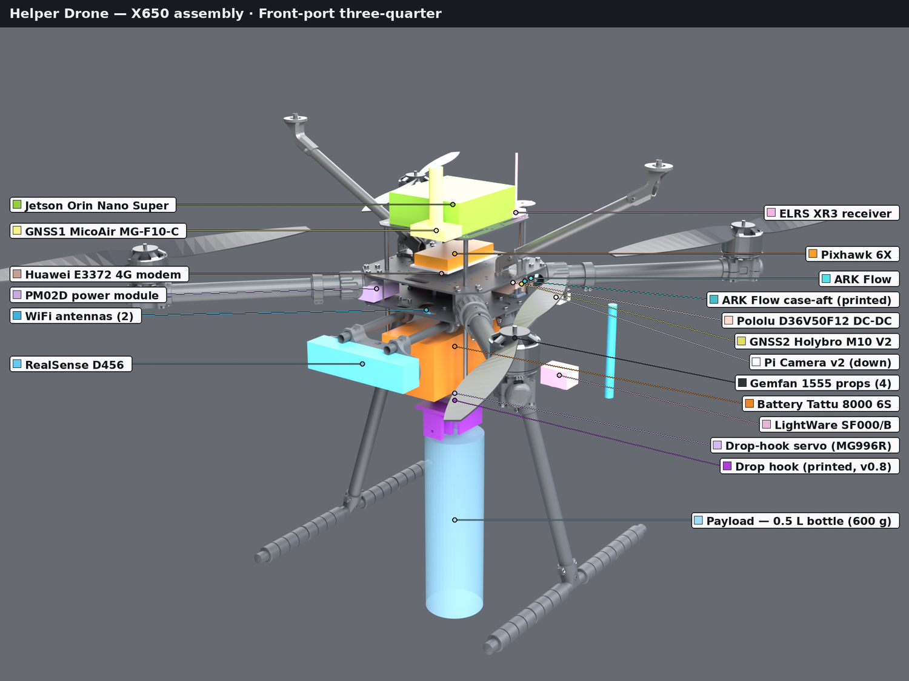
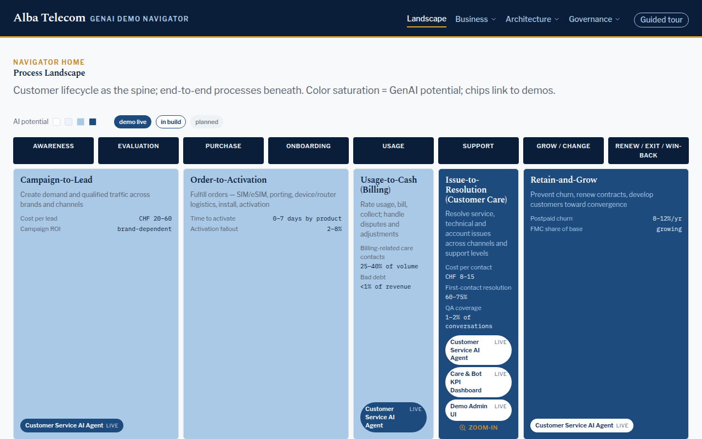

# David Hellekalek

I spent the last fourteen years in enterprise architecture and AI consulting, most recently as Principal for Enterprise AI at Infosys Consulting, where I led the architecture and delivery of a multinational logistics group's GenAI customer-care agents, live since early 2024 and used by thousands of employees across 30+ countries. Before that: digital enterprise architecture at Accenture.

What I enjoy most is building systems that have to work outside a slide deck. These days that means an autonomous drone, agents wired to real enterprise systems, and a voice assistant that answers my phone. Based near Zürich, Switzerland.

Most of my current work lives in private repositories, so this page links to the things you can actually try.

## Projects

### 🚁 Helper Drone &nbsp;private · Python, C++, ROS 2, ArduPilot

An autonomous X650 quadcopter for supply drops and environment monitoring, designed to keep flying when GPS is jammed or gone. Pixhawk 6X running ArduPilot 4.7 with DDS, a Jetson Orin Nano Super as companion computer, a RealSense D456 feeding cuVSLAM for visual-inertial odometry, depth-based obstacle avoidance through ArduPilot's BendyRuler, a 4G link, and a 3D-printed servo drop hook for the payload.

The whole stack runs in Gazebo with failure injection in CI, and the avoidance chain has been proven end to end in simulation. The airframe is built, flashed, and bench-tested; the simulation worlds, CAD, printed parts, and build manual all live in the repo. Around 2,900 commits so far. The render above is the current assembly.

### 🤖 GenAI Demo Platform &nbsp;live demo · Python, TypeScript

A collection of enterprise agentic AI demos for a fictional telco, each one fully functional at proof-of-concept level: real FastAPI backends, Postgres, persisted data, and fake CRM and billing systems you can break things against. A Next.js navigator maps the demos onto the customer lifecycle so business stakeholders can find the one that matters to them.

**[Open the demo navigator →](https://navigator.demo.hellekalek.com/)**

### 📞 Voice Personal Assistant &nbsp;live · Python, FastAPI, Postgres

A realtime voice agent you can actually phone. It handles my mailbox and voicemail, reads and drafts Gmail behind a sanitizer, knows my contacts, remembers things across calls, searches the web, places outbound calls on a schedule, and can bridge a live call to me. Tools are tiered, so anything consequential waits for my approval on the dashboard before it happens.

**Call it: +41 55 539 11 66.** Ask it what it can do.

### 📈 ib-mcp &nbsp;open source · Python

A Model Context Protocol server that exposes read-only Interactive Brokers data to LLMs: contracts, historical bars, option chains and quotes, news, fundamentals, portfolio and account. Built on ib_async and FastMCP, with trading deliberately left out. I use it for my own investing conversations with Claude.

**[Source on GitHub →](https://github.com/Hellek1/ib-mcp)**

### 🚌 viaja-facil &nbsp;open source · Java, Google App Engine

Where this started. During a stay in Buenos Aires in 2010 I wrote a public transport router for the city and its suburbs, solo, in a few months: a Java backend on App Engine, a GWT web frontend, an Android app, and a tool for building the bus-route library. It ran from 2011 to early 2019, reached up to 300,000 users a month with over 120,000 app downloads, and taught me early what a PaaS could do for a one-person consumer product. Open-sourced in 2015 when I ran out of time to maintain it.

**[Source on GitHub →](https://github.com/Hellek1/viaja-facil)**

## Also

- A PyTorch model that predicts benchmark-relative stock moves from a local Interactive Brokers data warehouse: intraday and daily bars, implied volatility, borrow fees, news embeddings, and point-in-time fundamentals. Signals go to a human; it never trades on its own.
- A dual RTX 3090 rig for running open-weight LLMs locally.
- My [CV](https://github.com/Hellek1/david_hellekalek_cv) is LaTeX, built in a Docker container on GitHub Actions and published as a release.

## Find me

[LinkedIn](https://linkedin.com/in/david84/) · [CV as PDF](https://github.com/Hellek1/david_hellekalek_cv/releases/download/latest/david_hellekalek_cv_public.pdf)
